<div align="center">

# Study Guides (Agent Skill)

**Turn lecture slides, PDFs, notes, or codebases into single-file, 100% offline interactive HTML study guides — while cutting LLM output tokens by ~80%.**

[](https://github.com/XLVII-DEV/study-guides/actions/workflows/ci.yml)
[](./LICENSE)
[](#-features)
[](#-quick-usage-cli)

**[Live Interactive Demo (GitHub Pages)](https://xlvii-dev.github.io/study-guides/)** · **[Installation](#-installation)** · **[Examples](./examples/)**  
Language: **English** · **[Català](#català)** · **[Español](#español)**

<br/>



</div>

---

## What Is It?

Instead of asking an AI agent to rewrite 2,400 lines of HTML, CSS, and JavaScript every time, **`study-guides`** separates **pedagogical content** from the **audited interactive engine**:

```text
  [ Lecture PDFs / Notes / Code ]
                 │
                 ▼   The LLM writes only 6 lightweight slots (.slots.txt)
  [ scripts/build_guide.py ]  ──▶  Verifies offline purity, DOM safety & quiz anti-bias
                 │
                 ▼
  [ Study_Guide.html ]        ──▶  1 offline file: Theory + Practice + Exam + Anki + A4
```

---

## Why `study-guides` vs Manual Coding or a Generic AI Prompt?

| Criterion | Hand-coded manually | Generic AI prompt | With `study-guides` Skill |
| :--- | :--- | :--- | :--- |
| **Time & effort** | Hours writing CSS/JS | Constant manual prompt fixes | **1 command, `~60 ms` build** |
| **LLM output tokens** | — | `~37,150` tokens (`2,387` lines) | **`~7,382` tokens (`-80.1%`, `5x` cheaper)** |
| **Quiz quality** | Hard to balance options | Option `B` or longest is always right | **Strict anti-bias audit (`PASS`/`FAIL`)** |
| **Dark mode & A4 print** | Hard to maintain | Dark SVGs turn invisible; 10-page dumps | **3 presets + dark mode + clean `Cmd+P` A4** |
| **Active study tools** | Static text | Basic Q&A | **Timed Exam + Saved mistakes + Anki `.tsv`** |
| **Editing later** | Editing tangled HTML | Re-generating from scratch | **`--extract` pulls clean 6 slots back out** |

---

## Features

- **Master Professor Pedagogy (4-Move Cards)**: guides agents to explain *intuition first*, *internal mechanism* (with dark-mode-safe `<svg>` + `<ol class="step-trace">`), a *worked example*, and *side-by-side mistake comparisons* (`.compare-grid`) + `.key-takeaway`.
- **3 Visual Presets + Warm Dark Mode**: choose `warm-serif` (Bronze/Ocre reading paper), `ink-editorial` (Ivory + Burgundy), or `slate-tech` (Crisp Slate + Petrol Teal) — all with dark mode, `/` sidebar search, and 1-click `Copy` buttons on code blocks.
- **3-Level Anti-Bias Quiz + Timed Exam Mode**: splits questions into *Foundations*, *Application*, and *Mastery* with runtime Fisher-Yates shuffling, persistent `localStorage` scores (`/10`), active mistake-retry mode, and a **Timed Exam Mode** that hides feedback until submission.
- **1-Click Anki Export (`.tsv`)**: exports every quiz item and `<details class="oral-check">` card directly to an Anki-ready UTF-8 `.tsv` file with level and source tags.
- **Dark-Safe A4 Print (`@media print`)**: pressing `Cmd/Ctrl + P` automatically formats a crisp 1–2 page cheat-sheet even while browsing in dark mode.
- **Lossless Round-Trip Editing (`--extract`)**: pull editable 6-slot files back out of any compiled guide in milliseconds.
- **7 Native UI Languages**: `en`, `es`, `ca`, `fr`, `de`, `pt`, `it` out of the box (plus full `"ui"` overrides).

---

## Installation

Compatible with **Antigravity, Claude Code, Cursor, OpenAI Codex, Windsurf, and Gemini CLI**:

```bash
npx skills add XLVII-DEV/study-guides
```

Or clone manually if `npx` is unavailable:

```bash
git clone https://github.com/XLVII-DEV/study-guides.git ~/.agents/skills/study-guides
```

---

## Example Prompts

- *"Use study-guides to turn my Operating Systems PDFs and lab exercises into an interactive study guide (`en`, undergraduate level)."*
- *"Use study-guides with the `ink-editorial` preset to build an exam prep guide and Anki deck from my Cellular Respiration notes."*
- *"Extract the slots from `Study_Guide_SQL.html` and add 6 harder Level III edge-case questions."*

---

## Quick Usage (CLI)

```bash
# Compile either included example (warm-serif CS or ink-editorial Biology)
python3 scripts/build_guide.py examples/cs_acid_transactions.slots.txt -o Study_Guide_ACID.html --min-questions 12
python3 scripts/build_guide.py examples/biology_cell_respiration.slots.txt -o Study_Guide_Bio.html --min-questions 12

# Extract slots back from a compiled guide for quick edits
python3 scripts/build_guide.py --extract Study_Guide_ACID.html -o acid.slots.txt

# Run the standalone test suite (Python 3.9+, zero third-party packages)
python3 -m unittest discover -s tests -v
```

---

<details id="català">
<summary><strong>Català — Resum, avantatges i instal·lació</strong></summary>

### En què consisteix?
**`study-guides`** és una *Agent Skill* que converteix apunts, PDFs o codi en una **guia d'estudi HTML interactiva en un sol fitxer 100% offline**. En lloc de fer que la IA reescrigui milers de línies d'HTML/CSS/JS, l'agent només redacta **6 blocs lleugers (`.slots.txt`)** i `scripts/build_guide.py` els compila i audita automàticament.

### Avantatges respecte a fer-ho a mà o amb un prompt normal
- **5x menys tokens (`-80.1%`)**: passa de `~37.150` tokens a `~7.382` tokens per guia.
- **Test sense biaixos garantit**: `verify_html_quiz.py --strict-guide` bloqueja que una lletra o la resposta més llarga guanyi per defecte, tant globalment com per nivell (`I`, `II`, `III`).
- **Estudi actiu complet**: inclou explicacions en 4 moviments (*intuïció → mecanisme → exemple resolt → error típic vs com es fa bé*), exercicis d'arrossegar/omplir, **Mode Examen cronometrat**, **exportació Anki (`.tsv`) en 1 clic** i **impressió A4 neta (`Cmd/Ctrl + P`)**.
- **Edició sense pèrdua (`--extract`)**: pots extreure els 6 slots d'un HTML ja compilat, editar-los i recompilar en mil·lisegons.

### Instal·lació ràpida
```bash
npx skills add XLVII-DEV/study-guides
# o manualment:
git clone https://github.com/XLVII-DEV/study-guides.git ~/.agents/skills/study-guides
```

</details>

<details id="español">
<summary><strong>Español — Resumen, ventajas e instalación</strong></summary>

### ¿En qué consiste?
**`study-guides`** es una *Agent Skill* que transforma apuntes, PDFs o código en una **guía de estudio HTML interactiva en un único archivo 100% offline**. En lugar de hacer que la IA reescriba miles de líneas de HTML/CSS/JS, el agente solo redacta **6 bloques ligeros (`.slots.txt`)** y `scripts/build_guide.py` los compila y audita automáticamente.

### Ventajas frente a hacerlo manualmente o con un prompt normal
- **5x menos tokens (`-80.1%`)**: pasa de `~37.150` tokens a `~7.382` tokens por guía.
- **Test sin sesgos garantizado**: `verify_html_quiz.py --strict-guide` impide que una misma letra o la opción más larga sea siempre la correcta, tanto globalmente como por nivel (`I`, `II`, `III`).
- **Estudio activo completo**: explicaciones en 4 pasos (*intuición → mecanismo → ejemplo resuelto → error común vs forma correcta*), ejercicios de rellenar, **Modo Examen cronometrado**, **exportación a Anki (`.tsv`) en 1 clic** e **impresión A4 limpia (`Cmd/Ctrl + P`)**.
- **Edición sin pérdida (`--extract`)**: extrae los 6 slots de cualquier HTML ya compilado para modificarlo y recompilarlo al instante.

### Instalación rápida
```bash
npx skills add XLVII-DEV/study-guides
# o manualmente:
git clone https://github.com/XLVII-DEV/study-guides.git ~/.agents/skills/study-guides
```

</details>

---

## License

MIT — see [LICENSE](./LICENSE).
